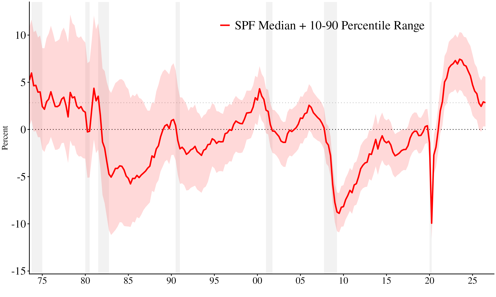

# The Nominal GDP Expectations Gap

This repository tracks and visualizes the U.S. NGDP Expectations Gap using microdata from the **Survey of Professional Forecasters (SPF)** (Federal Reserve Bank of Philadelphia) and historical NGDP data from **FRED** (Federal Reserve Bank of St. Louis).

## Methodology
The methodology is described in Martinez, Schibuola and Beckworth (2026) "The Reliability of the Nominal GDP Expectations Gap", International Journal of Central Bank Volume 22, No 2 (April 2026), https://www.ijcb.org/journal/v22n2/reliability-nominal-gdp-expectations-gap.

## Latest NGDP Expectations Gap Estimate

*Last updated: 2026-11-02 19:40 UTC*
